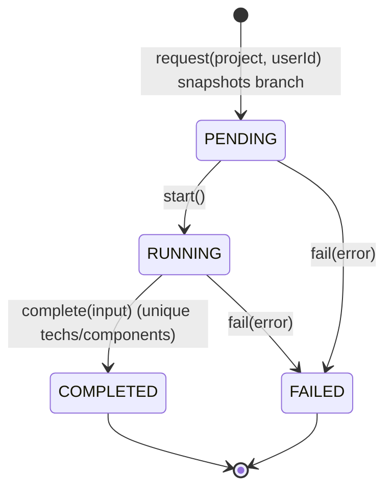
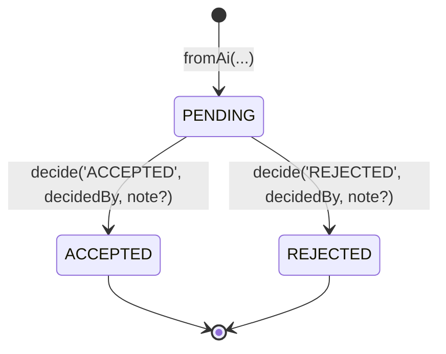
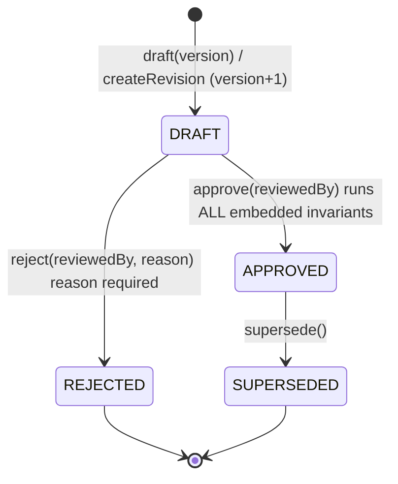
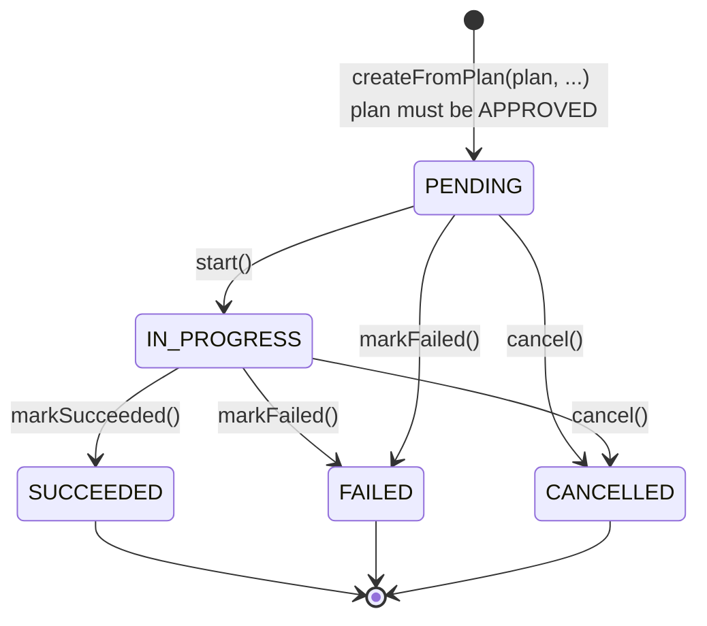
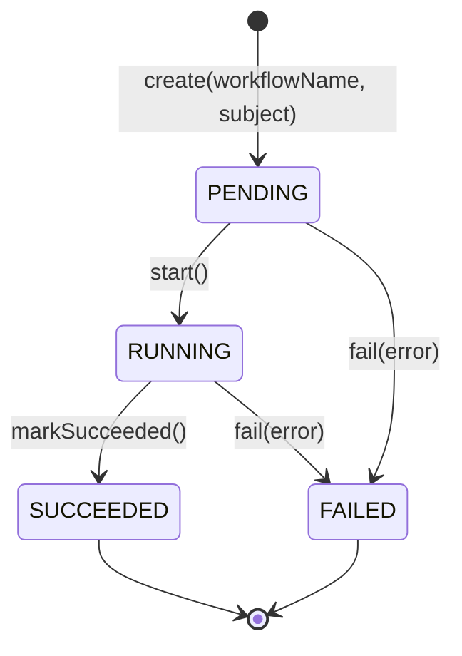
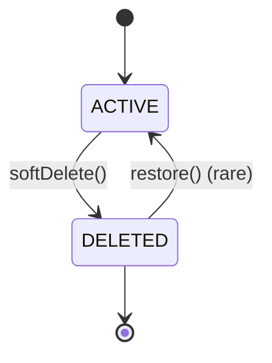

# Domain model — DeploymentPlanner AI backend

Mongoose 9, one file per model under `src/models/entities/`. Composition: the
`softDeletePlugin` (User, Project) and shared value-object subschemas
(`resource-spec`, `hpa-spec`, `ingress-spec`, `repository-ref`, `error-info`).
Serde: `_id`→`id`, `createdAt`/`updatedAt`, no `__v`/`passwordHash`/`accessToken`
in JSON output.

## Entity-relationship diagram

```mermaid
erDiagram
    USER ||--o{ PROJECT : "owns"
    USER ||--|| GITHUB_CONNECTION : "1 token"
    USER ||--o{ ANALYSIS : "requestedBy"
    USER ||--o{ DEPLOYMENT_PLAN : "createdBy / decidedBy"
    USER ||--o{ DEPLOYMENT : "triggeredBy"
    USER ||--o{ WORKFLOW_RUN : "triggeredBy"

    PROJECT ||--o{ ANALYSIS : "analyses"
    PROJECT ||--o{ DEPLOYMENT_PLAN : "plans"
    PROJECT ||--o{ GENERATED_FILE : "artifacts"
    PROJECT ||--o{ DEPLOYMENT : "deployments"

    ANALYSIS ||--o{ RECOMMENDATION : "owns"
    RECOMMENDATION }o--o{ DEPLOYMENT_PLAN : "plan.recommendations[]"
    POLYMORPHIC_RUN_SUBJECT: ANALYSIS ||--o{ WORKFLOW_RUN : "subject (refPath)"
    POLYMORPHIC_RUN_SUBJECT_PLAN: DEPLOYMENT_PLAN ||--o{ WORKFLOW_RUN : "subject (refPath)"
    POLYMORPHIC_RUN_SUBJECT_DEPLOYMENT: DEPLOYMENT ||--o{ WORKFLOW_RUN : "subject (refPath)"
    DEPLOYMENT_PLAN ||--o{ GENERATED_FILE : "plan + planVersion"
    DEPLOYMENT_PLAN ||--o{ DEPLOYMENT : "plan + planVersion"
    DEPLOYMENT_PLAN ||--o{ DEPLOYMENT_PLAN : "previousPlan (revisions)"
    USER ||--o{ AUDIT_LOG : "actor"
    ANALYSIS }o--|| DEPLOYMENT_PLAN : "plan.analysis"
```

Polymorphism: `WorkflowRun.subject { type: 'ANALYSIS'|'PLAN'|'DEPLOYMENT', id }`
uses `refPath: 'subject.type'`; `AuditLog.entity { type, id }` stores strings
(no refPath — the log is independent of model lifetimes).

## State machines (`defineStateMachine`, invalid transitions throw `InvalidStateTransitionError`, message: `Invalid state transition: cannot move from "X" to "Y"`)

### Analysis.status


### Recommendation.status

Deciding again throws (one decision, final).

### DeploymentPlan.status (optimisticConcurrency on, versionKey `__v`)

Component add/update/remove only in DRAFT; at least one component; unique
component names; new versions start as fresh DRAFTs (JSON deep-copied
components) and must not be persisted together with `supersede()` in one call
by the model — services own that pair.

### Deployment.status

`recordArgoStatus` / `recordGitopsCommit` merge runtime details onto the doc.

### WorkflowRun.status


### Soft delete (User, Project — plugin)

Deleted docs remain reserved for unique fields (User.email keeps colliding) and
are invisible to default queries — repositories opt in with `withDeleted`.
Transition errors: `Already soft deleted` / `Already active`.

## Cross-document rules deferred to services

| Rule (exact) | Collections touched | Transaction |
|---|---|---|
| `Analysis.request` asserts `project.assertCanBeAnalyzed()` (repo verified + project active), then writes ONE `analyses` doc that snapshots the branch; `project`/`requestedBy` are plain refs (no copy) | projects (read), analyses (write) | no — single write; the assert is an indexed read |
| Approving a plan then appending an audit entry (`PLAN_APPROVED`) is logically one operation | deployment_plans (write), audit_logs (append) | yes — but tolerable eventually consistent: audit failure never rolls back the action |
| `DeploymentPlan.supersede()` + `createRevision()` = mark old SUPERSEDED + insert fresh DRAFT (version via `nextVersionFor`) | deployment_plans (2 docs, same collection) | yes — the unique `(project,version)` index stays the last line of defence |
| `Deployment.createFromPlan` reads the plan (`assertApproved()`) and writes one deployment copying `planVersion`/`project` | deployment_plans (read), deployments (write) | no — single write of a copy |
| `DeploymentPlan.attachRecommendation` / `Analysis`+recommendation flows rely on the recommendation belonging to the same analysis; the plan stores only the ref | recommendations (read), deployment_plans (write) | no — ref append guarded by a duplicate check |
| `DeploymentPlan.createRevision` copies the components of the previous plan (JSON deep copy, `previousPlan` set) and re-computes the version with `nextVersionFor` | deployment_plans (read + insert) | yes — same rationale as supersede+draft |
| `GeneratedFile.generate` for `K8S_*`/`GITHUB_WORKFLOW` kinds requires the CURRENT APPROVED plan (`findApprovedByProject`) + its version; `DOCKERFILE` needs plan OR analysis | deployment_plans/analyses (read), generated_files (write) | no — planVersion baked in at write time, staleness detected via `isStaleFor(plan)` |
| Registering a workflow run for a subject (analysis, plan, deployment) writes ONE `workflow_runs` doc with the polymorphic subject | analyses/plans/deployments (read), workflow_runs (write) | yes when launched together with the triggering action |
| Unique guards: one GithubConnection per user; User.email unique (reserved by deactivated docs); `(owner,name)` unique for live projects; `(project,version)` unique for plans | github_connections / users / projects / deployment_plans | no — single-doc writes; indexes are the guard (duplicate key surfaced as Mongoose save error) |
| Every audited action: service calls `AuditLog.record` (actor id, entity type/id, metadata) AFTER the action succeeds; append-only | audit_logs (append) | no — append-only, eventual consistency acceptable |
| Admin "errors" view = `AuditLog.listErrors(['ERROR','WARN'])` | audit_logs (read) | no |

## Deviations from the French report (and reasons)

| Deviation | Reason |
|---|---|
| Password hashing uses **argon2id** instead of bcrypt | Memory-hard KDF, modern recommendation; `@node-rs/argon2` (native, fast, no JS fallback) |
| Central error-code→HTTP status table in `middleware/error-status-table.ts` | Domain errors carry a `code`; ONE table owns the mapping — adding an error class = one row |
| State machines via a framework-free `defineStateMachine<S>` helper instantiated per status field | Transitions are pure and unit-testable; models only assert inside behavior methods |
| Deprecated `validateSync` (Mongoose 9) was used in unit tests | Every use now goes through `await doc.validate()`; banned repo-wide via ESLint `no-restricted-properties` — see `conventions.md` (Testing approach) |
| Project documents carry repository-verification extras (`isValid`, `defaultBranch`, `verifiedAt`, `verifyError`) beyond the initial field list | The analysis gate (`assertCanBeAnalyzed`) needs verification state; prevents launching analyses against an unverified repo |
| GithubConnection keeps the encrypt-then-store payload `{iv,authTag,cipherText}` with `select:false` and honeypot-like invariant enforcement (active⇒token present, revoked⇒wiped) | Nothing speculative: encryption is per spec (AES-256-GCM) with the base64 key from env |
| `AuditLog` uses `Schema.Types.Mixed` for `metadata`, the only allowed Mixed in the codebase | Event payloads are shaped per emitting site; schema-level shapes would be speculative |
| `AuditLog` removes default `updatedAt` (createdAt only) and blocks updates/deletes/`replaceOne` + non-insert `save()` | Append-only per spec |
| DeploymentPlan re-enables `versionKey:'__v'` (schema default strips `__v` from JSON) | `optimisticConcurrency:true` requires a real versionKey in Mongoose 9; `false` crashes `save()` |
| Generics in repositories/typing pattern used `Record<never, never>` for empty query/virtual slots and one documented narrow cast in `BaseRepository.__ctor` | Mongoose 9 model types don't structurally reduce to the abstract `Model<TFields, object, TMethods>` shape; the cast is the single documented escape hatch |
| No default sort on generic `find`; each list finder declares its own order | Zero speculative behavior; service needs stay explicit |
| `nextVersionFor` counts REJECTED/SUPERSEDED plans when computing the next version | Literal reading of the spec ("latest existing plan + 1"); also keeps versions monotonic |

## Assumptions the team should confirm

- `Project.environment` = `['DEVELOPMENT','STAGING','PRODUCTION']` (per `project.enums.ts`).
- `WorkflowRun.subject.type` = `['ANALYSIS','PLAN','DEPLOYMENT']`; `subject.type` stores the ENUM value while mongoose `refPath` resolves model names — services map enum→model name (`Analysis`, `DeploymentPlan`…) at populace time if needed.
- `GeneratedFile.kind` = `['DOCKERFILE','K8S_DEPLOYMENT','K8S_SERVICE','K8S_INGRESS','K8S_HPA','K8S_CONFIGMAP','GITHUB_WORKFLOW']`; `K8S_*` + `GITHUB_WORKFLOW` REQUIRE `plan`+`planVersion`, `DOCKERFILE` needs plan OR analysis.
- GitHub repositories only (provider `github`); other DRMs rejected by `parseGitHubUrl`.
- One GithubConnection per user (unique `user`); revoking wipes `accessToken` (no ciphertext remains).

## Lifecycle & cascade rules — OPEN (documented only; NOTHING is implemented)

Each rule below lists the possible strategies and the team's current lean.
`OPEN` means no model/service/runbook change has been made; the section is the
 agreed vocabulary for the discussion. These rules interact — the Project
 soft-delete block should be decided as ONE package.

### 1. What does the Project soft delete do to its children?
Project.softDelete() stamps `deletedAt` on the project doc only. Today the
children (analyses, deployment plans, generated files, deployments, workflow
runs, audit logs) keep `deletedAt: null` and look "live" in their own queries.

- **Option A — read-time filtering everywhere.** Every aggregate lookup for a
  project joins the project and skips deleted owners. No writes, history
  always available, but every consumer must remember the filter (easy to get
  wrong; hidden coupling).
- **Option B — write-time cascade.** `Project.softDelete()` also stamps a
  `projectDeletedAt` on each child (or a boolean `orphaned`). Cheap reads,
  one writer, but multi-document writes need a bounded fan-out or a job and a
  resumability story; partially-applied cascades need a reconciliation sweep.
- **Option C — MongoDB multi-document transaction.** Same as B but atomic for
  a bounded project size; child count is small in practice (tens of plans and
  files). Requires a replica set (transactions) both locally (MongoMemoryReplSet)
  and in production.
- **Status-gating (must-have in any option).** Analyses in PENDING/RUNNING and
  Deployments in PENDING/RUNNING need a hard stop (crash their state machine
  with CANCELLED/OVERWRITTEN) BEFORE they look forever-running. A deleted
  project's live IN_PROGRESS deployment would otherwise keep running jobs.
- **Recommendation (leaning B or C, plus status-gating).** Mark all five
  statuses and any "assertCan*" helpers to reject deleted project refs. `OPEN`.

### 2. What does User deactivation (soft delete) do to projects they own?
The `(owner, name)` partial-unique index only guards LIVE owners, so a new
owner can take the name after deactivation. Today ownership refs stay.

- **Option A — leave refs.** Projects stay owned by a deactivated user;
  UI must handle "ghost owner"; the owner can no longer log in
  (`assertCanAuthenticate`).
- **Option B — mandatory ownership hand-off before deactivation.** Only
  allowed when every owned project is deleted or transferred to an active
  owner (the multi-user version of this platform doesn't exist yet — with one
  owner, deactivation implies deleting those projects).
- **Option C — deactivation DELUES the owned projects** (same cascade as rule 1,
  date-stamped by `deactivatedAt`).
- **Recommendation (leaning B for data hygiene).** `OPEN`.

### 3. Deleting a Project that has an IN_PROGRESS deployment
Deleting (or hard-draining) the project while at least one deployment is
`IN_PROGRESS` is the most dangerous case.

- **Option A — block the delete.** `projectRepository.assertNoRunningDeployments`
  (one indexed query) — complete or cancel the running deployment first, then
  the delete can run. Safest UX.
- **Option B — cancel-then-delete.** The delete helper cancels every PENDING/
  RUNNING deployment (state machine → CANCELLED/OVERWRITTEN) in the same
  transaction, then soft-deletes.
- **Option C — allow orphaned RUNNING deployments** (deployment docs with a
  `deletedAt`-stamped project ref) and let the cancel sweep pick them up.
  Almost never desirable: it produces "success" writes against deleted
  resources and confusing audit trails.
- **Recommendation (leaning A for v1 — a blocking error with a pointer to the
  RUN).** `OPEN`.

### 4. Multiple PENDING/RUNNING analyses per project — allow or enforce single-flight?
Today nothing stops a user from launching analysis #2 while #1 is RUNNING.

- **Option A — partial unique index** `analyses (project) WHERE status IN
  ('PENDING','RUNNING')`. `--apply` starts it from the sync script. Strongest
  guarantee, one migration, but no project-by-project copy semantics and it
  fails confusingly if there is ever a legit multi-branch analysis flow.
- **Option B — service-level single-flight assert** (`assertNoRunningAnalysis`),
  no schema change. Enforced only through the service layer; direct repo
  writes can bypass it; still simple and reversible.
- **Option C — allow concurrency.** Analyses over the same branch storm the
  provider (the gate exists for the branch snapshot, not the parallelism).
- **Recommendation (leaning B, revisit if a branch-scan feature arrives).**
  `OPEN`.

### 5. Domain `version` vs Mongoose `__v` (optimistic concurrency)
Two "versions" collide in vocabulary:
- `DeploymentPlan.version` — domain version for the plan chain
  (`nextVersionFor`, business rules, display).
- `__v` — Mongoose document version incremented by `optimisticConcurrency: true`
  saves; version-internal, one number per DOCUMENT lifetime, unrelated to the
  domain chain.

Risks: the API may expose both (or only one), tests may conflate them, and a
supersede flow that copies `__v` would look right in one repo and break in
another.

- **Option A — document the separation** (done in this section) and add repo
  state to NEVER surface `__v` outside the optimistic-concurrency concern.
- **Option B — rename the domain field** per model (`chainVersion`, …). Big
  diff, callsite churn; serialization already hides `__v` for consumers.
- **Option C — reuse `__v` AS the domain version.** They count different
  things; equal numbers are a coincidence; strongly discouraged.
- **Recommendation (leaning A — vocabulary only, plus a repo/test guard for
  exposed `__v`).** `OPEN`.
